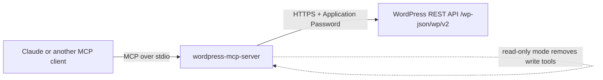

# wordpress-mcp-server

[](https://github.com/bgildea/wordpress-mcp-server/actions/workflows/ci.yml)


An [MCP](https://modelcontextprotocol.io) server that lets Claude, and any other MCP-capable agent, read a WordPress site and draft new posts through the WordPress REST API.

Ask your assistant things like *"what did we publish about the conference last month?"*, *"which plugins are out of date?"* or *"draft a post announcing early-bird tickets"*, and it works against your real site.

## Product brief

**Who it's for:** people who run WordPress sites (agencies, in-house web teams, membership organisations) and want an AI assistant that knows what's actually on the site.

**Problem:** assistants can write content but can't see the site it's going into. People copy and paste between the dashboard and the chat, and drafts get written without knowing what already exists.

**Key decisions**
- **Drafts only.** The assistant can create drafts but cannot publish, edit or delete. A person always presses Publish. See [ADR 001](docs/decisions/001-drafts-only.md).
- **Read-only mode.** `WP_READ_ONLY=true` removes every write tool, for sites where even drafts aren't wanted.
- **Plain text out.** Content comes back as clean text, not raw HTML, so the model spends its context on meaning rather than markup.
- **Application Passwords, not admin passwords.** Uses WordPress's built-in, revocable per-app credentials.

**What success looks like:** a site owner connects it in a couple of minutes and gets useful answers about their own site without giving the assistant power to break anything.

## Tools

| Tool | What it does | Needs credentials |
| --- | --- | --- |
| `get_site_info` | Site name, tagline, URL and REST namespaces | No |
| `list_posts` | Posts or pages, with search, status filter and paging | Only for non-published statuses |
| `get_post` | One post or page with content as plain text | No (published content) |
| `list_comments` | Comments, optionally for one post, with search, status filter and paging. Never returns author emails | Only for held, spam or trashed comments |
| `get_comment` | One comment with its text as plain text | Only for unapproved comments |
| `list_plugins` | Installed plugins, versions and active status | Yes, administrator |
| `create_draft_post` | Creates a new post as a draft | Yes, author or above |

## How it works



- `src/wordpress.ts`: a small typed REST client with timeouts, clear errors and HTML-to-text conversion
- `src/server.ts`: registers the MCP tools with input validation (zod) and read-only hints
- `src/index.ts`: reads config from environment variables and connects over stdio

## Setup

**Requirements:** Node.js 20+, a WordPress site with the REST API enabled (the default).

```bash
git clone https://github.com/bgildea/wordpress-mcp-server.git
cd wordpress-mcp-server
npm ci
npm run build
```

Create an Application Password in WordPress under **Users > Profile > Application Passwords**. Use a dedicated user with the lowest role that does the job (Author is enough for drafts).

### Connect it to Claude Desktop

Add this to your MCP config file (`claude_desktop_config.json`):

```json
{
  "mcpServers": {
    "wordpress": {
      "command": "node",
      "args": ["/absolute/path/to/wordpress-mcp-server/dist/index.js"],
      "env": {
        "WP_URL": "https://your-site.com",
        "WP_USERNAME": "your-user",
        "WP_APP_PASSWORD": "xxxx xxxx xxxx xxxx xxxx xxxx",
        "WP_READ_ONLY": "false"
      }
    }
  }
}
```

Leave out `WP_USERNAME` and `WP_APP_PASSWORD` to browse published content only.

### Configuration

| Variable | Required | Description |
| --- | --- | --- |
| `WP_URL` | Yes | Site root, e.g. `https://example.com` |
| `WP_USERNAME` | No | WordPress username for authenticated calls |
| `WP_APP_PASSWORD` | No | Application Password for that user (spaces are fine) |
| `WP_READ_ONLY` | No | `true` to disable all write tools |

## Development

```bash
npm test          # vitest: REST client and MCP tools, against a mocked WordPress
npm run typecheck # strict TypeScript, tests included
npm run build     # compile to dist/
```

The tests run the real MCP server against an in-memory MCP client, so they check tool listing, argument validation and error handling exactly as an agent would see them.

## Security notes

- Credentials live in environment variables, never in the repo
- Use HTTPS. Application Passwords are sent as Basic auth
- Give the WordPress user the smallest role that works, and revoke the Application Password when you stop using it
- Tool output is content from your site. Treat anything an agent reads there as data, not instructions. This matters most for comments, which anyone visiting the site can write

## Roadmap

- [x] `list_comments` and `get_comment` for moderation help
- [ ] WooCommerce read tools (orders, products) behind a separate flag
- [ ] Media library search
- [ ] Publish to npm for `npx` usage

## Licence

MIT. Built by [Barry Gildea](https://github.com/bgildea), who has spent 15+ years building on WordPress.
